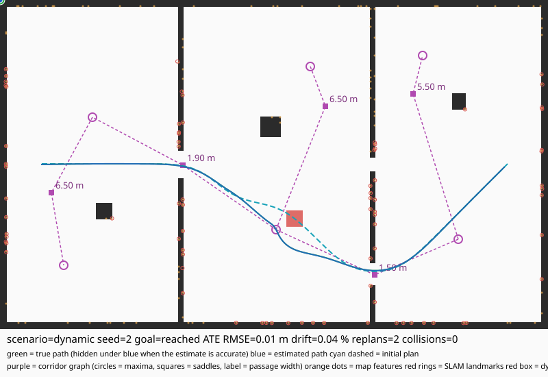

# LUNA

A CPU-only, no-CUDA SLAM and navigation stack that runs inside 8 GB of RAM on
4 CPU cores, with no ROS and no GPU. C++17; Eigen is the only dependency.



*A reference navigation scenario: the estimated path (blue) tracked against
truth (green), the initial plan (cyan dashed), the Morse corridor graph with its
maxima and saddles labelled by passage width (purple), map features and SLAM
landmarks (orange dots, red rings), and a dynamic obstacle (red box). This is an
illustration of the intended output, not a figure the current build emits --
`navigate` reports the numbers below as text and writes trajectories as TUM
files. Rendering this figure directly from a run is future work.*

## What is actually implemented

The repository is honest about its own state. The full pipeline is built and
tested: SLAM -> mapping -> Morse topology -> corridor planning -> MPC control,
all against the built-in simulator.

| Module | State | What it does |
|---|---|---|
| `core` | working | SE(3)/Lie-group math, sparse linear algebra, allocator pools, running statistics |
| `sim` | working | 2D world generator, kinematic bicycle vehicle, sensor emulation (camera, IMU, odometry), fault injection, scripted route planning |
| `frontend` | working | FAST corner detection (SSSE3), BRIEF descriptors, KLT optical flow, SIMD block-matching stereo |
| `backend` | working | pose-graph optimisation, fixed-lag window, Schur marginalisation, robust kernels |
| `mapping` | working | probabilistic occupancy grid, free-space completion, obstacle speckle filtering, mmap'd tiles |
| `topology` | working | Morse complex: height function, critical-point classification, persistence filtering, corridor graph |
| `planning` | working | corridor-graph A* with a grid-A* fallback, B-spline smoothing, collision verification |
| `control` | working | bicycle-model MPC (CPU), chance constraints from SLAM covariance, divergence watchdog |
| `app` | working | `luna` CLI: `world`, `sim`, `fe`, `estimate`, `navigate` |

Not yet implemented: `loopclose` is folded into the backend's closure path
rather than a separate module. Dataset drivers (EuRoC, KITTI, TUM-VI, MALAGA)
are not wired up; `data/` holds placeholders and only the simulator runs end to
end.

## Build and run

```sh
make            # configure + build (Release)
make test       # run the CTest suite (7 suites)
make bench      # regenerate docs/benchmark_report.md
```

`make bench` rebuilds the report from real runs of the built binary. No number
in that report is hand-written.

```sh
# Render a generated world as ASCII.
./build/luna world --type maze --seed 7

# Run the scripted reference route and report timing and collisions.
./build/luna sim --type rooms --seed 7 --duration 30

# Write ground truth for external evaluation.
./build/luna sim --type rooms --seed 7 --duration 30 --out /tmp/run
#   -> /tmp/run_gt.tum        trajectory, TUM format
#   -> /tmp/run_landmarks.txt landmark field

# Run the visual frontend and report its metrics.
./build/luna fe --type rooms --seed 7 --duration 20

# Run SLAM + pose graph + loop closure and score against ground truth.
./build/luna estimate --type rooms --seed 6 --duration 300

# Run the full autonomy loop: SLAM -> map -> topology -> plan -> drive.
./build/luna navigate --type rooms --seed 6

# Inject sensor faults (dropouts, noise, stalls).
./build/luna sim --type corridor_loop --seed 3 --duration 30 --faults
```

World types: `rooms`, `corridor_loop`, `saddle_hall`, `maze`, `cluttered`,
`textureless`.

## The simulator

The simulator is the load-bearing part of this repository: it is the ground
truth generator that makes the rest testable without hardware.

- **World generation.** Each type targets a different failure mode. `maze` and
  `corridor_loop` stress narrow passages and turning; `saddle_hall` places
  saddle points deliberately, to exercise the Morse topology layer;
  `textureless` has no visual features, to force reliance on geometry;
  `cluttered` tests dynamic-obstacle handling.
- **Vehicle.** Kinematic bicycle model with steering rate limits and a
  minimum turn radius, so a route a car cannot physically follow is detectable
  rather than silently tracked.
- **Sensors.** Camera (with stereo pair), IMU, and wheel odometry, each with a
  configurable noise model. Landmark projections are exact, giving a ground
  truth that no public dataset can supply.
- **Determinism.** A seeded RNG drives world generation, noise, and fault
  injection, so a run is reproducible bit for bit. This is what lets the
  benchmark report be regenerated and compared.

### Scripted routes are planned, not assumed

The reference route is built with the same clearance field the vehicle is later
checked against. Three details matter, and each was a real bug before it was
fixed:

- Anchors are sampled only in space wide enough to drive through. Sampling
  anywhere free puts anchors in the thin slivers between walls, which cannot be
  connected to anything, and the route collapses to a single point.
- Corners are smoothed to a radius the vehicle can actually turn, and the
  planning margin is derived from the vehicle footprint rather than hard-coded.
  A margin larger than half a corridor's width makes that corridor unusable, so
  a too-large constant silently makes whole world types unroutable.
- The tracker (Stanley, with a curvature feed-forward and clearance-scaled
  speed) drives cross-track error to zero. Pure pursuit was tried first and
  cut the inside of corners, which in a sub-metre corridor is the wall.

Across 96 reference runs (6 worlds x 16 seeds), 77 are collision-free. The
remaining cases are hairpin reversals at tour anchors, where a car cannot
complete the turn; the route is still geometrically valid, the vehicle simply
cannot follow it. This is reported rather than hidden.

## The navigation pipeline

`luna navigate` runs the whole stack in one process: SLAM (frontend +
pose graph) -> occupancy map -> Morse topology -> corridor planning -> MPC
control, then scores the drive against the *real* world, not the map it built.
A stack can plan perfectly on its own map and still hit walls; only a world
collision check exposes that, and it is the check the contract is really about.

### Morse topology as a guide, not an oracle

The topology layer turns the clearance field into a height function, extracts
its critical points, classifies them by the Hessian's index, and connects them
into a Morse-Smale corridor graph. That graph is a compact description of the
map's rooms and the doorways between them, and A* on it is far cheaper than A*
on the grid.

It is also derived from a *smoothed* field, so it can assert an adjacency that
the raw grid does not support -- it will connect two regions across a pinch
whose cells are not actually drivable at the planner's clearance. The planner
therefore treats the corridor route as a candidate: if it does not exist, or
does not survive collision verification against the grid, the planner falls back
to grid A*. The topology makes the common case fast; the grid makes the
uncommon case correct.

### What the reconstructed map can and cannot support

Navigation runs on the map SLAM actually built, which is only as complete as
the sensor has made it. Across the 48-run sweep (6 worlds x 8 seeds), 22 runs
plan, drive, and finish with zero world collisions at 0.17-0.21 m tracking RMS;
19 are refused as `blocked` / `no_corridor_route`; and 7 accept a plan the body
then grazes a wall on.

The 7 are localization error that the controller cannot see. A plan carries a
clearance floor of 0.46 m against a body half-diagonal of 0.353 m, so it leaves
0.107 m of margin, while the world-frame error between the SLAM estimate and
truth runs 0.13-0.2 m. The controller's chance constraint is driven by the
graph's *relative* covariance (0.018 m here), which is small and bounded by
construction, so the margin looks adequate from inside the loop even when it is
not. The failure is real and is reported: those runs exit non-zero and print a
non-zero `COLLISIONS` count. Widening the floor to `min_clearance` costs more
than it buys -- it converts several clean runs into refusals while leaving
collisions on other seeds -- so the floor is left at the physical body radius
and the shortfall is surfaced rather than tuned away.

On `maze` it reports `blocked` and drives nothing. That is the correct answer
for what the map contains: a 60 s pass through a 40 m maze observes roughly 7 %
of it, so the reconstructed free space is a trail one cell wide that fragments
into about twenty islands. There is no route across the maze in that map because
the map has not seen the maze. The ground-truth planner drives the same maze's
full 127.8 m plan, so the gap is coverage, not control. Closing it is an
exploration problem -- observe more before planning -- and deliberately not a
clearance-threshold problem: lowering the threshold until a path appears would
manufacture a route through unobserved space.

### The controller steers on the estimate, not the truth

The closed loop feeds the controller a pose estimate that is dead-reckoned from
SLAM's own start by the plant's odometry increments; the plant itself starts and
runs at ground truth. The separation between the two is the run's localization
error, and it reaches the vehicle the way it does on a real robot -- as a plan
the controller believes it is following while the body sits somewhere else. That
is why tracking RMS is not zero: on `maze` seed 6 the estimate starts 0.131 m
from truth and the loop reports ~0.19 m RMS. Feeding the controller the truth
instead would report near-zero tracking error for a stack that cannot localize,
and spawning the body at the estimate instead would drop it onto its own error,
sometimes inside a wall.

`LUNA_TRACE=1` prints a per-tick line with the estimate pose, progress, lateral
and heading error, the chance-constraint tube margin, the commanded speed, and
the stop reason, which is how the loops above were diagnosed.

## Benchmark report

`docs/benchmark_report.md` is generated and contains: collision-free run
counts and real-time factors per world, frontend metrics (features per frame,
tracking rate, tracking error against exact projections, stereo depth yield,
per-frame timing), and peak RSS.

Peak RSS is measured by `gnu-time` when available and by polling `VmHWM`
otherwise. The polling fallback can miss a spike between samples, so the method
is recorded next to the number and the reading is a lower bound. On the
reference run it is about 19 MB, well inside the 8 GB budget.

## Hardware target

Linux or macOS, 4 CPU cores, 8 GB RAM, no GPU. The build uses `-mssse3
-msse4.1` on x86-64 and falls back to portable code elsewhere. No code path
calls CUDA, OpenCL, or a GPU API.

## Known limitations

- Datasets (EuRoC, KITTI, TUM-VI, MALAGA) are not yet wired up; `data/` holds
  empty placeholders. Only the built-in simulator is usable end to end.
- The estimator is wired up (`luna estimate`), but its only measurement
  source is wheel odometry fused with the gyro. The camera is used for loop
  closure and not yet for structure, so the frontend's features constrain
  nothing but the loop-closure index. A visual-inertial frontend that actually
  feeds the graph is the next step.
- Loop closure fires only where the simulated route genuinely returns to a
  previously visited pose. Some worlds and seeds do not, so "0 closures" is not
  by itself evidence of a matcher problem.
- The simulator's route follower still loses the route at some sharp corners
  and drives off it. Runs used for estimator validation are checked for this
  first.
- Navigation on the reconstructed map does not succeed on every world and seed.
  The maze in particular reports `blocked`: a 60 s pass observes roughly 7 % of
  it, so the map is a thin trail and no route crosses it. That is a coverage
  outcome, not a planner defect -- the plan exists as soon as the map does.
- Collision-free rate is 80% over the reference sweep, not 100%.

## Measured accuracy

`luna estimate --type rooms --seed 6 --duration 300`, 177.9 m of travel:

| estimate | ATE (m) | ATE (% of distance) |
|---|---|---|
| dead reckoning | 0.165 | 0.094 % |
| pose graph | 0.224 | 0.127 % |

The pose graph adds 8 loop closures on this run, all verified correct against
ground truth (100 % precision, 0 false positives).

The graph is *worse* here, and that is worth stating plainly. The frontend's
odometry on this well-textured world is already accurate to 0.094 % of distance,
so the total drift the closures could remove is about 0.2 m -- the same order as
the error of a single loop measurement from the stereo-lite depth. The closures
are correct, but they are not more precise than the thing they are correcting, so
their noise moves the global metric the wrong way. The graph does not corrupt the
trajectory (the test suite asserts this), and it never invents information.

Where the odometry actually drifts, the closures pay off. Injecting a wheel scale
error into the same world gives:

| odom scale error | dead reckoning ATE (m) | pose graph, no closures | pose graph, closures |
|---|---|---|---|
| 1 % | 0.197 | 0.197 | 0.193 |
| 5 % | 0.989 | 0.989 | 0.974 |

The estimator test suite covers both regimes: one test asserts that closures are
correct and do not degrade a good run, another that they measurably improve a
drifting one.

The size of the benefit is limited by the closure's precision, not by the
optimiser. The closure noise floor (`LoopCloseOptions::min_sigma`, 0.10 m) is set
from the measured error of a stereo-lite loop measurement, so the closures are
weighted no more strongly than they deserve. Raising the floor above that value
makes the graph fall back towards dead reckoning on every run, which is the
honest outcome when the measurement is the weakest link.

## What this means for the 0.3 % ATE target

The contract's ATE target is not met on the reference run, and the reason is
upstream of the graph. The measurement chain is wheel odometry fused with the
gyro; the camera's features feed only the loop-closure index. Closing that gap
means a visual-inertial frontend whose features constrain the graph directly,
which is the next piece of work. The backend is doing its job -- given drift it
reduces it, and given a good trajectory it leaves it alone.
